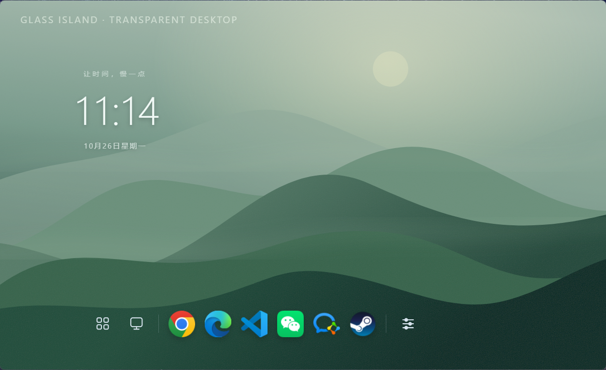
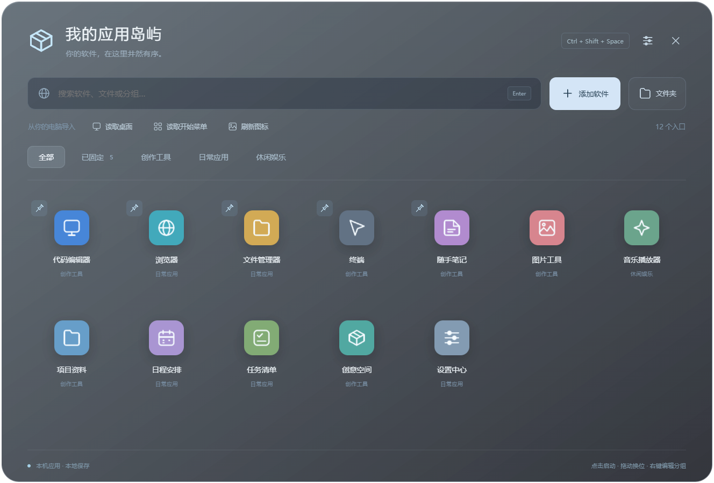
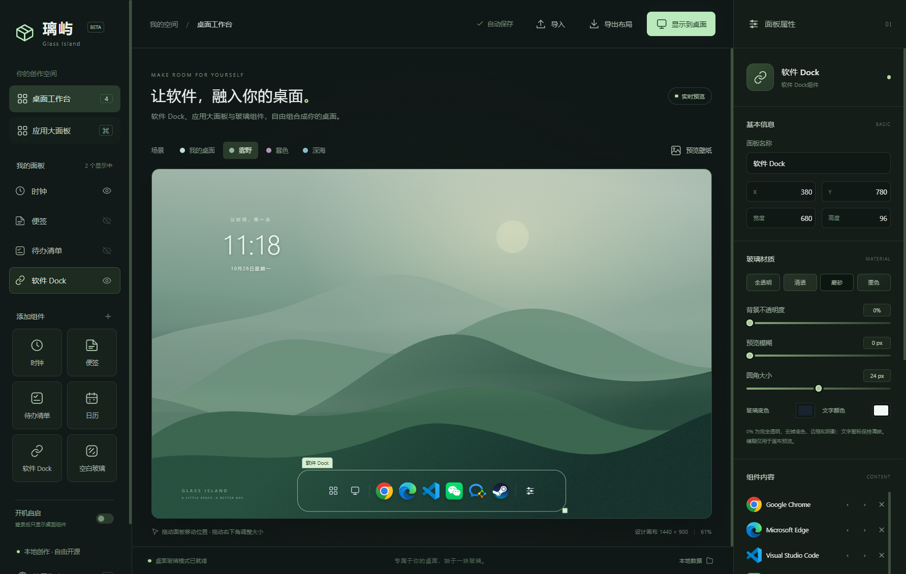

# 璃屿 · Glass Island

**让软件，融入你的桌面。**

Windows 本机软件启动器与玻璃桌面工具。包含应用大面板、软件 Dock、时钟、便签、待办、日历和空白玻璃。无需账号，数据存本机，MIT 开源。

[下载 Windows 免安装版](https://github.com/baikaiwen075-dot/glass-island/releases/latest) · [查看源码](https://github.com/baikaiwen075-dot/glass-island)






## 运行

双击 `release/Glass-Island-0.4.1-win-x64.exe`，免安装，不需要另装 Node.js。程序需要 Windows 10/11 x64 与 .NET Framework 4.8（常见 Windows 10/11 已内置）。桌面窗口使用逐像素透明，不依赖系统亚克力背景，避免圆角外出现灰色矩形。

开发运行需要 Node.js 22.12+：

```powershell
npm ci
npm start
```

也可以双击 `启动璃屿.cmd`。首次安装依赖需联网。国内环境若 Electron 官方下载不可用，可临时设置 `ELECTRON_MIRROR=https://npmmirror.com/mirrors/electron/` 后重试 `npm ci`；下载仍按 npm 包内的官方校验值验证。

## 先把自己的软件放进来

1. 首次启动会打开“应用大面板”，也可以点击工作台左侧入口或按 `Ctrl + Shift + Space` 唤出。
2. 点击“读取桌面”或“读取开始菜单”，检查候选列表，勾选后点击“添加已选”。扫描只读取入口，不会移动或删除桌面文件。
3. 也可以点击“添加软件”，选择一个或多个 EXE / LNK 快捷方式；点击“文件夹”可添加目录入口。支持直接从桌面或资源管理器拖入。
4. 点击软件图标启动。LNK 由 Windows 打开，保留原快捷方式的启动参数和工作目录。图标读取实际软件或快捷方式的图标，不再用网站首字母代替。
5. 点击卡片上的图钉固定到 Dock。取消固定保留大面板入口；移除入口只删璃屿记录，不卸载软件、不删除原文件。
6. 右键卡片或点击“···”可以修改名称、输入分组名称、查看文件位置和取消固定。输入新分组名称即可创建分组；搜索与分组共同筛选，搜索后按 Enter 启动第一项。

支持本机软件、快捷方式、文件夹，以及 PDF、文本、Office 文档、常见图片和媒体文件。入口依赖原路径；移动原文件后需重新添加。应用列表最多 800 个；桌面及开始菜单扫描默认跳过卸载入口和符号链接，扫描深度最多 6 层。

## Dock 与玻璃桌面

- 工作台点击“显示到桌面”，显示软件 Dock 和可见组件。Dock 包含应用大面板、此电脑、已固定的软件和设置。
- 从桌面直接拖入 Dock，会创建软件入口并固定，不移动原文件。
- Dock 默认自动隐藏：鼠标离开原范围约 0.45 秒后隐藏，移回该范围即显示，隐藏时不拦截桌面点击。拖动图标或缩放时保持显示。在工作台选中“软件 Dock”，可关闭“自动隐藏 Dock”恢复常驻。
- 在应用大面板和桌面 Dock 中，按住软件图标拖动即可换位，其他图标会自然让位；松手自动保存，Esc 取消。分组或搜索后的排序只调整当前可见的软件。也可在工作台使用左右箭头调整已固定软件的顺序。超出宽度的图标可以横向滚动，或扩大 Dock。
- 在画布中拖动和缩放组件，右侧调整位置、尺寸、底色、预览模糊、圆角、文字颜色、锁定和置顶。
- “我的桌面”读取当前系统静态壁纸用于排版；也可自选预览图片。不会更改系统壁纸。动态壁纸仍由原壁纸软件负责。
- 非置顶组件通过本项目自制 Windows 桥接程序，将窗口所有者设为 Explorer 的桌面窗口，减少 Win + D 隐藏普通悬浮窗的问题。每 3 秒检查一次绑定以处理 Explorer 重建；如绑定失败，界面会显示提示，继续使用普通半透明窗口。
- 桥接程序的桌面绑定仅调整当前璃屿进程拥有的窗口；“此电脑”使用固定的 Windows Shell 对象并恢复对应资源管理器窗口，不修改系统文件、注册表、任务栏或桌面图标的显示开关。设置“始终置顶”会改为普通置顶悬浮窗口。
- 桌面便签直接输入，待办点击复选框或整行即可完成/撤销，计数和进度即时刷新；日历可点上月、下月及“本月”。拖动组件顶部移动，右键打开编辑器。锁定只禁止移动和缩放，仍可操作内容。

## 0.4.1 桌面待办与日历交互

- 修复桌面待办按钮获得焦点后不刷新的问题，直接勾选、撤销会立即更新划线、计数和进度，并同步到工作台、自动保存。连续操作使用主进程中的最新状态，避免快速点击互相覆盖。
- 日历增加“上个月 / 本月 / 下个月”按钮，支持跨年、闰年；仅当前月份高亮今天。查看月份会保存，点击“本月”恢复跟随系统日期。桌面和工作台都可操作。
- 全透明和锁定位置下，待办和日历按钮仍可直接操作。按钮空白处保留最低透明度的鼠标命中区域，面板空白背景、圆角外仍为全透明。
- 全局鼠标穿透仍按用户选择生效；开启时，交互组件显示“Ctrl + Shift + L 恢复点击”提示。
- 自动测试隐藏编辑器，使用真实 Windows 鼠标点击复选框与翻月按钮，验证即时反馈、透明/锁定、跨年、二月 29 日、同步和重启保存。

## 0.4 图标换位、自动隐藏与此电脑

- 应用图标拖动时保留占位，周围图标平滑让位；支持跨行、分组、搜索结果和 Dock 内的换位。取消拖动不会保存，拖动不会误启动软件。
- Dock 使用屏幕鼠标位置唤出，完全隐藏后仍可找回；移动或缩放 Dock 后，唤出范围跟随新位置。全透明外观与自动隐藏可同时使用。
- 修复“此电脑”点击无反应：打开系统 Shell 对象，并恢复可能被旧版隐藏的对应窗口。
- 图标顺序与自动隐藏开关保存在原布局中，升级保留原应用、分组和固定状态。

## 0.3.1 应用图标修复

- 按快捷方式原始图标位置读取 `.ico`、EXE/DLL 内嵌图标，保留正负资源编号，支持环境变量、带空格的路径和相对路径。
- 旧版误保存的白纸图标会在首次启动时自动重新提取，并在刷新前保留 `before-icon-repair.json`。不需要删除软件重新导入。
- 大面板上方可点“刷新图标”；手动选择的自定义图标不会被批量刷新覆盖。
- 右键应用或点击“···”，可以“更换图标”或“恢复默认图标”。支持 ICO、PNG、JPEG、BMP 图片，应用大面板与 Dock 同步更新。
- 软件本身不提供图标、或原路径已失效时，可以手动选择图标。图标读取不会启动、安装或修改原软件。

## 0.3 透明效果与开机自启

- 工作台选中面板，在“玻璃材质”点击“全透明”，或将“背景不透明度”设为 **0%**：背景、边框、阴影全部消失，只显示文字和图标。不会降低文字、图标的清晰度。
- “清透”保留 8% 淡色背景和细玻璃边缘；新时钟默认全透明，Dock 默认清透，并隐藏软件名称，可在属性栏重新开启名称。
- 圆角外是透明像素，不再铺灰色矩形。原生窗口固定为无边框透明窗口，缩放由右下角悬停显示的把手完成；锁定后把手隐藏。
- 从旧版升级会先备份 `before-upgrade-v03.json`，再应用新透明默认值。软件入口、分组、笔记和待办保留。
- 工作台左下角提供“开机自启”开关。开启后，当前 Windows 用户登录时仅恢复桌面组件和托盘，不弹出工作台或应用大面板；关闭开关移除本软件的启动项。
- 免安装版登记原始外层 EXE，而不是临时解压目录。请放在固定位置；移动或升级到新文件名后重新开启自启，以更新启动路径。
- 自启偏好由 Windows 管理，不包含在导出布局中，导入别人的布局不会自动启用启动项。若 Windows 任务管理器禁用了该项，开关旁会提示，可重新开启。
- 测试使用独立命名的临时启动项，验证开启后会移除，不改变真实用户的璃屿自启选择。

## 快捷键与托盘

| 快捷键 | 功能 |
| --- | --- |
| Ctrl + Shift + Space | 展开 / 收起应用大面板 |
| Ctrl + Shift + G | 打开外观编辑器 |
| Ctrl + Shift + L | 鼠标穿透 / 恢复交互 |
| Ctrl + Shift + H | 显示 / 隐藏桌面组件 |
| Ctrl + D | 工作台复制选中面板 |
| Delete | 工作台删除选中面板，需要确认 |
| Esc | 收起应用大面板或关闭当前对话框 |

全局快捷键被其他软件占用时，可通过系统托盘执行同一操作。右键托盘“退出璃屿”完全退出。应用大面板的关闭按钮只收起窗口。

## 保存、迁移和开源

点击工作台右下角“本地数据”查看实际保存目录，通常为 `%APPDATA%/Glass Island/`。

- `layout.json` 保存软件路径、图标、分组、固定状态、组件内容和布局。停止操作约 250 ms 落盘，正常退出再次保存。
- `layout.json.bak` 为上一次保存前的副本。
- 从 v0.1 升级会先生成 `before-upgrade-v02.json`，将旧网站栏调整为软件 Dock，其余组件数据保留。
- 导入布局会先确认，再保存 `before-import.json`。损坏配置不会静默覆盖。
- 导出布局包含本机路径、软件名称、笔记和可能的预览壁纸；公开分享前检查个人内容。换电脑不会一起复制软件，目标路径必须在新电脑上存在。

源码可直接上传 GitHub；`.gitignore` 已排除依赖、构建产物、测试数据、个人布局、旧个人截图和生成的桥接二进制。推送 `v*` 标签或手动运行 Actions 可构建 Windows 免安装程序，产物为 Actions artifact；发行版和安装包可在 Releases 下载。

```powershell
npm run check
npm test
npm run test:ui
npm run build:dir
npm run build
```

`test:ui` 使用独立测试目录和自制测试软件，验证原组件编辑、应用导入、实际 LNK 启动、搜索分组、Dock 固定、桌面所有者绑定、透明像素、缩放、自启开关、登录静默恢复、实际鼠标图标换位、资源管理器可见性和 Dock 多次自动隐藏/唤出，不修改用户桌面文件。该命令需要已登录的 Windows 交互桌面，测试期间会临时操作鼠标与测试窗口；GitHub Actions 运行语法检查、单元测试和打包。`build-native.cjs` 使用 Windows 内置 .NET Framework C# 编译器生成桥接程序，不增加运行时 npm 依赖。

## 当前范围

- 已实现应用大面板、软件 Dock、分组搜索和玻璃组件编辑，**不等同于完整复刻 GlassBoard**。
- 尚未实现正在运行的窗口切换、组件融合、系统音乐、联网天气、任务栏替换。
- 桌面所有者绑定依赖 Explorer；其他桌面外壳、特殊动态壁纸、多屏 DPI 和远程桌面的表现需逐项验证。本版工作台以主显示器排版，修改布局会重新映射到主显示器。
- 模糊滑块仅作用于画布预览；真实桌面使用逐像素透明与淡色玻璃边缘，不添加会遮挡壁纸的系统磨砂底板。
- 程序未做代码签名；发布者可自行添加签名。

## 参考与许可

产品交互参考 [SENLIN-SAMA/win-.- 的 GlassBoard 用户说明](https://github.com/SENLIN-SAMA/win-.-/blob/main/GlassBoard_v0.9.12_%E5%AE%A2%E6%88%B7%E8%AF%A6%E7%BB%86%E8%AF%B4%E6%98%8E%E4%B9%A6.md)，桌面窗口机制参考 [DeskWidgets](https://github.com/VaticUI/DeskWidgets)，并参阅 [Electron 窗口 API](https://www.electronjs.org/docs/latest/api/browser-window) 与 [安全指南](https://www.electronjs.org/docs/latest/tutorial/security)。

代码与素材自行实现，未复制参考软件的程序包、品牌、壁纸或专有代码。本项目代码、自制图标和默认 SVG 场景遵循 [MIT License](LICENSE)。本机软件图标属于对应软件，仅在用户本机显示；第三方依赖保留各自许可证。
